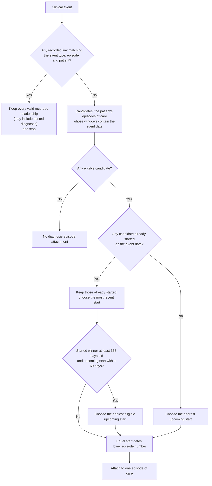
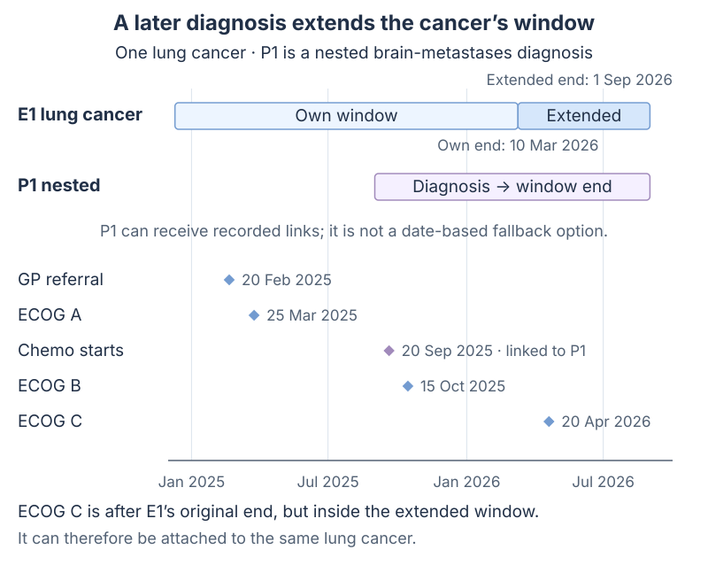
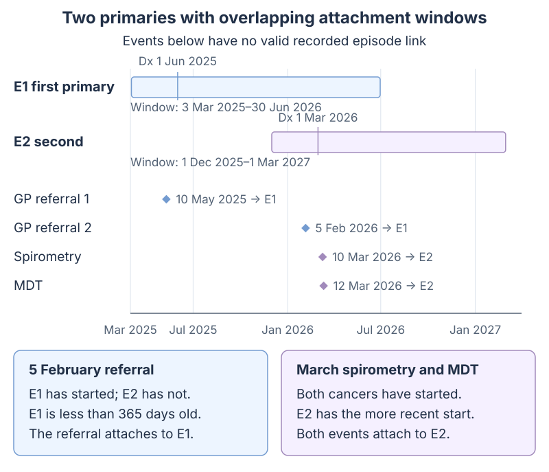

# Episode attachment and measure resolution

This page explains which cancer an assessment or treatment belongs to, and how that affects its quality indicators. It starts with the clinical rules and examples, then gives the details needed to use the data in queries. For how several records become one indicator result, see [From clinical evidence to one indicator result](evidence_and_indicators.md).

## Part 1: for clinicians

### Which cancers enter the report?

The cohort identifies a patient’s cancer by its diagnosis: one **episode of care** per top-level MOSAIQ diagnosis. A diagnosis recorded under another diagnosis is a **nested diagnosis**. It belongs to the same cancer and does not create a separate cohort entry when the cohort selects primary diagnoses, as described below. An indicator can then count cancers individually or count each patient once.

Treatment careplans and performed surgery reach the diagnosis recorded in the source. Care on a nested progression or metastatic diagnosis also counts for its same-patient episode of care, while remaining available on the nested diagnosis. This follows the recorded parent and does not move care between primaries.

Measurements, assessments, procedures and observations use valid recorded episode links when available; otherwise they use the date-window rules below. Specialist visits have a separate attachment rule.

!!! note "Assumption: cohorts select through the primary diagnosis"
    Every leaf measure reachable from a cohort definition must select through the **primary diagnosis** (`dx_primary`). Under this assumption, each cohort row identifies an episode of care. A nested diagnosis is not a cohort row even when its diagnosis codes match the cohort definition.

    Cohorts defined through any diagnosis (`dx_any`), stage (`dx_stage`) or metastasis (`dx_mets`) can also select nested diagnoses. The one-entry-per-cancer interpretation on this page does not apply to those definitions.

Two top-level diagnoses for one patient are treated as true second primaries, so the patient can have two cohort rows. Duplicate entry of one cancer as two top-level diagnoses is assumed to be managed through clinical data review; these rules do not merge those diagnoses.

### Attachment rules

| Area | Behaviour |
|---|---|
| Recorded event links | Keep every link that matches the event, its type, the episode and the patient; suppress date-window fallback for that event |
| Date-window attachment | Choose one eligible episode of care; nested diagnoses are not fallback candidates |
| Window | From 90 days before the episode starts to its recorded end date, or start + 365 days when no end is recorded; extend its end to the latest nested-diagnosis window end when that is later |
| Nested-diagnosis treatment | Keep direct evidence and credit its valid episode-of-care parent; deduplicate performed source activity |
| Measure criteria | Combine evidence for the same patient and cancer; apply exclusions to that cancer |
| Indicator evaluation | Check the criteria and date windows for each cancer; count each patient once if the indicator is configured to count patients |

### Step 1: how a clinical event finds an episode

1. **Recorded links.** Validate each recorded relationship against the event ID, kind of event, episode and patient. Keep every valid relationship, including relationships to nested diagnoses and relationships outside the date window. An event can retain several valid links. It does not also enter date-window fallback.
2. **Date window.** For an event without a valid recorded link, consider the patient's episodes of care whose windows contain the event date. Each window starts **90 days before** the episode starts and closes at the **later of its own window end and the latest window end of its nested diagnoses**. Each episode's window ends on its recorded end date, or **365 days after its start** when no end is recorded. A later progression or metastasis therefore extends eligibility for the same cancer. The original cancer’s window still starts at the same date.
3. **Choosing one.** Prefer candidates that had already started on the event date, then choose the most recent start. If none had started, choose the nearest upcoming start. If start dates are equal, choose the lower episode number. When the nearest eligible already-started episode began at least 365 days before the event, choose the earliest eligible upcoming episode starting within 60 days after the event, breaking equal starts by the lowest episode ID. Both thresholds are inclusive. A more recent started episode blocks this override, and a same-day start is already started. No concept list is used.
4. **No candidate.** The event has no diagnosis-episode attachment through this route, so an indicator using these diagnosis-linked event views cannot use it.

Specialist visits use a separate assignment based on proximity to the episode start. They do not use the event ranking above and may appear against more than one episode.

### Step 2: how the report checks an indicator

1. **Cohort.** Create one cohort row per episode of care that meets the cohort definition, dated at diagnosis. This depends on the primary-diagnosis assumption above.
2. **Criteria inside a measure.** Inclusions select records and exclusions remove them. OR accepts evidence for either criterion. AND requires both criteria for the same cancer. EXCEPT keeps cancers meeting its first criterion only when they do not meet the other criteria. The measure retains the dates needed to check timing later.
3. **Denominator and numerator.** The denominator identifies eligible cancers, either the **whole cohort** or a subset meeting specified criteria. The numerator identifies which of those cancers meet the indicator. In both cases, the evidence must belong to the same cancer and satisfy the configured date windows.
4. **Counting patients.** If the indicator counts patients rather than cancers, check each cancer first. Then count the patient once in the denominator if any cancer is eligible, and once in the numerator if any eligible cancer meets the criterion. Keep the supporting evidence from the cancer that meets it.

Evidence for one primary cannot satisfy an indicator for another, and repeated records do not cause the same cancer to be counted again. If a date needed to establish eligibility is missing, show the result as unresolved and exclude it from both totals. Numerator evidence also needs a date unless the question explicitly accepts undated records and has no date window. The [worked resolution examples](evidence_and_indicators.md) explain these cases and how results are assigned to reporting periods.

### Worked example 1: one cancer with a later nested diagnosis

- **E1** is a lung episode of care diagnosed 10 March 2025, with no recorded end date. Its own window runs from 10 December 2024 to 10 March 2026. P1 extends its upper bound to 1 September 2026.
- **P1** is brain metastases recorded beneath the lung diagnosis from 1 September 2025, with no recorded end date. Its own window ends on 1 September 2026. It can receive valid recorded links but is not a date-window candidate.

| Event | Attachment | Reason |
|---|---|---|
| GP referral, 20 Feb 2025 | E1 | Its date is inside E1's window |
| ECOG A, 25 Mar 2025 | E1 | Its date is inside E1's window |
| Chemotherapy careplan recorded against the brain-metastases diagnosis | P1 and E1 | The nested diagnosis retains its evidence and its root also receives credit |
| ECOG B, 15 Oct 2025 | E1 | P1 is not a date-window candidate |
| ECOG C, 20 Apr 2026 | E1 | P1 extends E1's window through 1 September 2026 |

For the E1 cohort row:

| Indicator | Kind | Result under the stated rules |
|---|---|---|
| ECOG documented | Whole cohort | Met: ECOG A is on E1 |
| Received systemic therapy | Whole cohort | Treatment is available on E1; it qualifies only if the treatment date meets the indicator window |
| Stage III NSCLC with ECOG 0–2 | Defined denominator | Met if stage III is on E1 and its ECOG evidence meets the criterion and date window |
| Stage III NSCLC who received systemic therapy | Defined denominator | Treatment on P1 counts for E1 when stage and treatment meet the indicator criteria and window |

Chemotherapy beginning 20 September is more than 90 days after E1's diagnosis. Root attribution makes the treatment available on E1, but it does not qualify for a 0..90-day indicator. A performed surgery on P1 likewise removes E1's false no-surgery state; a historical-surgery observation alone does not.

ECOG C occurs after E1's own 365-day horizon but inside the extended window. It reaches E1 through date-window fallback. P1 contributes its window end, but its start never competes with another primary's start in the ranking. If E1's own end already covers P1, extension does not shorten it.

### Worked example 2: two lung primaries

- **E1** is the first lung primary, diagnosed 1 June 2025, with a recorded end of 30 June 2026. Its window runs from 3 March 2025 to 30 June 2026.
- **E2** is the second lung primary, diagnosed 1 March 2026, with no recorded end date. Its window runs from 1 December 2025 to 1 March 2027.

| Event | Attachment under the stated rules | Why |
|---|---|---|
| GP referral 1, 10 May 2025 | E1 | Only E1's window contains it |
| GP referral 2 for the new lesion, 5 Feb 2026 | E1 | Both windows contain it, but E1 is less than 365 days old, so the upcoming-episode preference does not apply |
| Spirometry, 10 Mar 2026 | E2 | Both had started; E2 has the more recent start |
| MDT presentation, 12 Mar 2026 | E2 | As for spirometry |

The spirometry and MDT attach once, to E2. The referral for the new lesion attaches to E1 under the already-started preference, so it cannot start an E2 referral-to-specialist or referral-to-treatment calculation through episode-aligned matching. The upcoming-episode preference does not apply because E1 is less than 365 days old at the referral. If E1 instead began on 1 June 2024 and remained eligible, that 5 February referral would attach to E2: E1 is then at least 365 days old and E2 begins within 60 days. A valid explicit link to E1 still takes precedence.

Ranking by dates alone does not establish which cancer an event concerns. If E2 were a prostate primary, the lung MDT would still attach to E2 under this rule. Attachment is independent of the kind or content of an event.

## Query and output details

### Episode links supplied by `omop-constructs`

| Evidence | Identity and attribution |
|---|---|
| Generic events | Source table, source event ID and attached episode ID; valid explicit links take precedence over date-based assignment |
| Treatment and performed surgery | Recorded disease owner plus its eligible episode-of-care root; physical activity is deduplicated per target |
| Treatment intent | Source measurement IDs distinguish different records even when their concepts and dates agree |
| Treatment summaries | Wide regimen × course combinations and condition-date envelope rows; raw row counts are not patient or treatment counts |

The existing treatment measurables consume the attributed condition episode IDs. Indicator criteria and diagnosis-time evidence windows determine whether that attributed evidence qualifies for a report.

View-definition changes require a rebuild, followed by immediate ANALYZE in dependency order. See [Rebuilding and refreshing clinical materialized views](schema_management.md#rebuilding-and-refreshing-clinical-materialized-views).

### Matching and counting in `oa-cohorts`

Measures retain person, episode, resolver and evidence dates. Both whole-cohort and defined-denominator indicators match `(person_id, episode_id, measure_resolver)` before applying date windows. Missing episode linkage does not match. They produce one result per cancer; the configuration field `grain=patient` combines those cancer results into one result per patient. The default, `grain=episode`, counts cancers separately. Patient output rows use `person_id` as their resolver and include the cancer identities that support the result.

Treatment attribution and indicator timing are separate operations. An episode window determines which cancer can receive otherwise unlinked evidence; it does not replace a diagnosis-relative criterion or an interval between two events.

For configuring a window between diagnosis and another event, see [Temporal windows](measure_resolution.md#temporal-window-event-to-event-timing).
