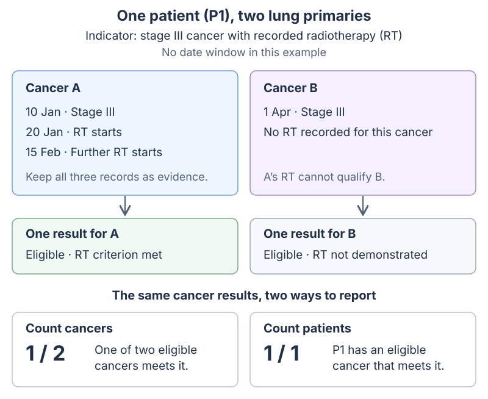
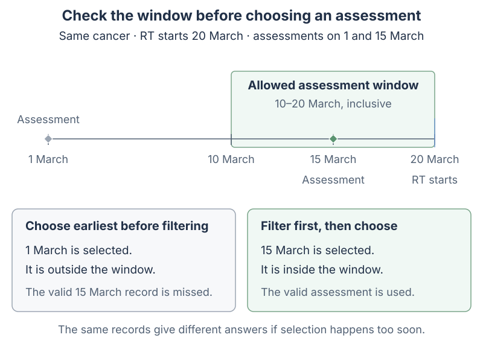

# From clinical evidence to one indicator result

A patient may have several assessments and treatments for the same cancer. Each record can help establish whether an indicator is met, but it should not cause that cancer to be counted again. Measures collect and combine this evidence. Indicators use it to decide which cancers are eligible (the denominator), which meet the criterion (the numerator), and whether the report counts cancers or patients.

The counts are numerator / denominator. Several records for A produce one cancer result. When counting patients, P1 meets the indicator through A; B is still not shown as having received RT.

Episode attachment is a separate decision from timing. A measurement attached to cancer B cannot pass an indicator for cancer A merely because the same patient has both. [Episode attachment](episode_attachment.md) explains recorded links, fallback date windows and nested diagnoses.

## Several records, one result

The following fictional patient has two lung primaries. The event labels distinguish the records; two events can remain separate even when they share a date. RT means radiotherapy.

| Patient | Cancer | Event | Date | Evidence |
|---|---|---|---|---|
| P1 | Lung A | E1 | 10 Jan 2026 | Stage III |
| P1 | Lung A | E2 | 20 Jan 2026 | RT start |
| P1 | Lung A | E3 | 15 Feb 2026 | Further RT start |
| P1 | Lung B | E4 | 1 Apr 2026 | Stage III |

For **Stage III AND RT**, A qualifies and B does not. For **Stage III OR RT**, both qualify. Several records for A still count as one eligible cancer.

| Expression | Evidence retained | First date A meets the criteria |
|---|---|---|
| Stage III OR RT | E1, E2 and E3 | 10 Jan |
| Stage III AND RT | Supporting stage and RT records, with completion dates | 20 Jan |
| Stage III EXCEPT RT | A is excluded because it has RT; B remains | None for A |

For an AND, the first qualifying date is the later of the earliest qualifying dates for its two criteria: `MAX(earliest qualifying A, earliest qualifying B)`. In this example, stage was recorded on 10 January and RT began on 20 January, so both requirements had been met by 20 January. This does not establish that the stage assessment was still clinically current when RT began. If that matters to the question, the definition needs a date window.

## Check the date window before choosing an assessment

Suppose diagnosis is 1 March, eligible RT starts 20 March, and assessment must be within **10 days before RT through RT start**, inclusive.

| Assessment date | Difference from RT | Qualifies? |
|---|---:|---|
| 1 March | −19 days | No |
| 10 March | −10 days | Yes, lower boundary |
| 15 March | −5 days | Yes |
| 20 March | 0 days | Yes, upper boundary |
| 21 March | +1 day | No |

The assessment on 1 March is too early, but it must not hide the valid assessment on 15 March. First find assessments inside the window, then apply the choice specified by the measure: keep all, the earliest, the latest, or the closest to treatment. In configuration these are `any`, `earliest`, `latest` and `closest`. Equally close assessments are ordered by earlier date, then source identifier. The 10-day interval is illustrative; each indicator needs its own clinical definition.

These three dates answer different questions. The configuration calls the event being checked the **candidate** and the event it is compared with the **anchor**:

| Date role | This example | Meaning |
|---|---|---|
| Assessment (`candidate`) | 15 March | When assessment happened |
| Treatment (`anchor`) | 20 March | The date the assessment is compared with |
| Completion | 20 March | When both dated requirements had occurred |

The measure can return the assessment date, the treatment date, or the earlier or later of the two. Its completion date is stored separately. For a later question about treatment start or end, use that treatment date rather than the date when a combined set of criteria was first met.

## A question about first treatment must use the first treatment

| Eligible treatment | Start | Assessment in its preceding 10 days | First-treatment question | Any-treatment question |
|---|---|---|---|---|
| T1 | 20 March | None | Fails | No qualifying assessment |
| T2 | 19 April | 14 April | Cannot rescue T1 | Passes through T2 |

Both questions count one eligible cancer. The first-treatment question fails because T1 has no qualifying assessment; the any-treatment question passes because T2 does. To answer the first-treatment question, select T1 before checking whether an assessment meets the criterion.

Start and end must belong to the same selected treatment. If T1 starts 10 January and ends 2 March, while T2 starts 20 January and ends 10 February, “end of the first treatment” is 2 March. It is not the earliest end among all treatments. The configuration therefore separates how a treatment is selected from which of its dates is used for comparison.

To count curative RT, the RT and curative intent must belong to the **same recorded treatment**. Palliative RT plus curative systemic anticancer therapy (SACT) does not establish curative RT. Repeated records of the same intent are retained. If one treatment has conflicting recorded intents, it is excluded from intent-specific criteria because its intent is uncertain. The treatment-intent data used here cannot identify cycles with no recorded intent; missing intent needs to be checked in the source data.

## Does the window run from diagnosis or treatment?

| Question | Denominator | Numerator timing | Result for the example |
|---|---|---|---|
| Documented assessment | Eligible cancer | No window | Met if a dated assessment is recorded |
| Assessment within 30 days of diagnosis | Cancer diagnosed 1 March | Relative to 1 March | 15 March passes |
| Assessment before first eligible RT | First eligible RT on 20 March | Relative to selected RT | 15 March passes in the example’s 10 days before RT |

By default, indicator windows run from the cohort date, usually diagnosis. Selecting treated cancers as the denominator does not change that reference date. To compare an assessment with the eligible treatment instead, set `numerator_reference=denominator`. Use a temporal-window measure for questions about specific start/end dates or more than one timing relationship.

When comparing with a treatment, evidence recorded against a particular treatment must refer to the selected treatment. An assessment with no treatment ID is checked by its date, within the same cancer.

## Should the indicator count cancers or patients?

The configuration field `grain` controls this choice: `episode` counts each eligible cancer, while `patient` counts each eligible patient once. The default is `episode`.

| Patient | Cancer | Eligible? | Criterion met? |
|---|---|---|---|
| P1 | A | Yes | No |
| P1 | B | Yes | Yes |
| P2 | C | Yes | No |

| Count | Denominator | Numerator | Interpretation |
|---|---:|---:|---|
| Cancers | 3 | 1 | One of three eligible cancers meets the criterion |
| Patients | 2 | 1 | One of two eligible patients has a cancer that meets the criterion |

When counting patients, first check each cancer separately. A patient is eligible if any of their cancers is eligible, and meets the indicator if any eligible cancer meets its criterion. Here P1 meets the indicator through cancer B. The result keeps B’s supporting evidence so the reader can see why. An earlier date from cancer A may determine P1’s reporting period, but it must not be shown as the treatment date that justified the result for B.

Repeated dates and cohort labels for one cancer do not increase the count. An indicator whose denominator is the whole cohort uses each cancer’s earliest dated cohort reference. Evidence for one primary cannot satisfy the criterion for another.

## Missing information and reporting periods

“No surgery recorded” does not have a surgery date. When an absence rule is combined with dated criteria, it checks eligibility without supplying a date: stage recorded on 10 January AND no surgery recorded qualifies on 10 January. Its source date stays empty. This differs from surgery that is recorded but has no usable date; that missing date cannot establish when a dated requirement was met. An absence-only measure cannot supply the anchor or candidate date for a window.

Death criteria check for an OMOP death record, independently of gender or other demographics. They use the calendar date of `death_datetime`, falling back to `death_date` when there is no timestamp. No death record means the death criterion is not met; it does not mean the patient is known to be alive. A recorded death with neither date available remains unresolved when its date is required.

If a date needed to establish eligibility is missing, the result is **unresolved**. Show it separately and exclude it from both numerator and denominator totals (`denominator_value=false`). If the cancer is eligible but has no qualifying numerator evidence, the criterion has not been demonstrated; that does not prove care was omitted. Undated numerator evidence is excluded by default. The `presence` setting can accept it when a question only asks whether something was recorded, but it cannot establish that an event fell within a date window.

| Evidence | Eligibility | Contribution |
|---|---|---|
| Dated eligible denominator, passing numerator | Eligible | Denominator 1, numerator 1 |
| Dated eligible denominator, no qualifying numerator | Eligible | Denominator 1, numerator 0 |
| Required denominator date missing | Unresolved | Neither total; show unresolved count |
| No denominator membership | Outside the eligible set | Neither total |

The indicator’s `period_date` determines where its result appears in a monthly or yearly report. It can come from the cohort, denominator, numerator or completion date. For example, if two AND criteria are met on 31 January and 1 February, their completion date is 1 February. A report using completion dates counts that result once, in February. Use the same period date for both numerator and denominator totals, and show results with missing period dates as unassigned rather than guessing a date.

When counting patients, cohort or denominator dates use the earliest eligible reference across their cancers. Numerator or completion dates follow the cancer that provides the supporting evidence for the patient’s result.

## Configuration reference

These settings make the choices above explicit. The defaults count cancers, accept any eligible treatment opportunity and compare indicator windows with the cohort date. [Schema management](schema_management.md#evidence-and-indicator-policies) explains how to upgrade the configuration database.

| Location | Field | Default / options |
|---|---|---|
| Indicator | `grain` | `episode` counts cancers; `patient` counts patients |
| Measure | `matching_scope` | `cancer`; `treatment` additionally requires equal non-null treatment identity |
| Temporal window | `anchor_selection` | `first`; also `latest`, `all` |
| Temporal window | `anchor_order_date_role` | `measure`; also `start`, `end`, `completion` |
| Temporal window | `anchor_date_role`, `candidate_date_role` | `measure`; also `start`, `end`, `completion` |
| Indicator | `opportunity_selection` | `any`; also `first` |
| Indicator | `numerator_reference` | `cohort`; also `denominator` |
| Indicator | `period_date_source` | `denominator`; also `cohort`, `numerator`, `completion` |
| Indicator | `undated_numerator_policy` | `exclude`; also `presence` |

When importing a CSV, omitted policy columns leave existing settings unchanged. Blank or unknown values are rejected. For SQL interfaces and the evidence fields available to developers, see [Measure resolution](measure_resolution.md).
