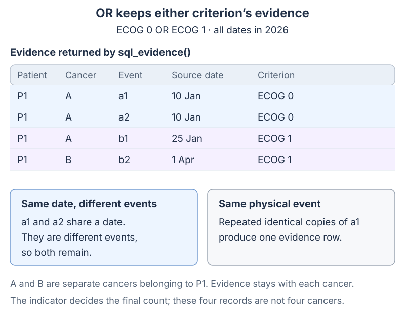
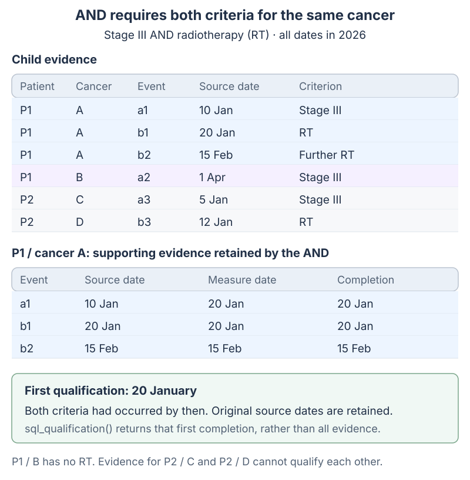
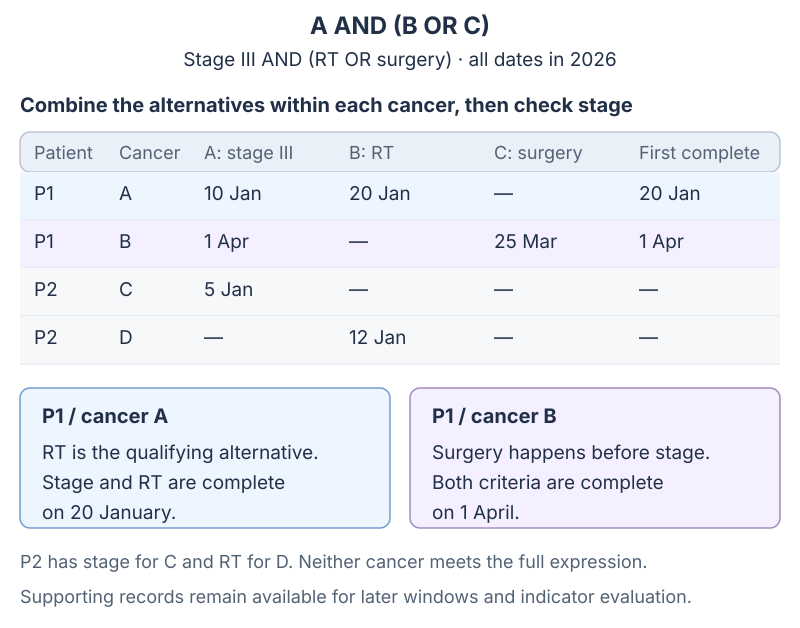

# Measure Resolution

For worked clinical examples, counting rules and date roles, start with [From clinical evidence to one indicator result](evidence_and_indicators.md). This page describes the SQL projections.

## The evidence returned by a measure

A measure returns `MeasureMember` rows. These identify the patient, cancer and date; additional fields retain source identifiers, treatment identifiers and dates needed by later criteria. The four core fields are:

```python
@dataclass(frozen=True)
class MeasureMember:
    person_id: int
    measure_resolver: int
    episode_id: Optional[int]
    measure_date: Optional[date]
```

A `MeasureMember` is not just a boolean membership flag. It captures:

* which patient and cancer the evidence belongs to
* which episode is used for matching (`measure_resolver`)
* the date returned by the measure

This preserved timing is what allows indicator windows, per-period reporting, and episode-aware logic to work later in the pipeline.

## Combining criteria

Measures combine evidence using `OR`, `AND` and `EXCEPT`. They retain the records and dates needed by later criteria. The indicator decides how that evidence contributes to the final count.

### `OR`: preserve all qualifying rows

`OR` keeps distinct qualifying evidence, deduplicating the same physical event.

Implementation shape:

* each child supplies evidence rows
* rows are combined with `UNION`
* all qualifying dates are preserved

Example:

* measure = ECOG 0 OR ECOG 1

If the same person qualifies on two different dates, both rows survive.



This is the full evidence result. The four-column `sql_any()` projection can merge distinct events that share a cancer and date; `sql_evidence()` retains their source identities.

### `AND`: both criteria for the same cancer

`AND` requires all child criteria to be met for the same cancer. Matching only the patient would allow evidence from one primary to qualify another.

Implementation shape:

* child rows are aligned by `(person_id, episode_id, measure_resolver)`
* first qualification is the latest of the earliest child completions; branch evidence remains available
* rows with mismatched resolvers do not qualify together

This gives the first date by which all required events had occurred. If the criteria must be met close together in time, add an explicit date window.

Example:

* measure = Stage III AND Radiotherapy

If Stage III qualifies under episode 10 and Radiotherapy qualifies under episode 10, the composite measure qualifies.

If the two child rows belong to different episodes, they do not intersect.



The stage record keeps its original `source_date` of 10 January. Its combined `measure_date` and `completion_date` are 20 January, when both requirements had occurred. Later RT evidence also remains available. `sql_qualification()` returns the first completion date for the cancer.

### Choosing a SQL result

Use the query that answers the question being asked:

* `sql_evidence()` preserves qualifying records, source identities and date roles.
* `sql_any()` returns distinct rows with the four core fields.
* `sql_first()` returns the earliest emitted date per `(person_id, episode_id, measure_resolver)`.
* `sql_qualification()` returns the earliest completion date per cancer: when all dated requirements had occurred.
* `sql_undated()` returns distinct membership keys without dates; it is unsupported for temporal-window measures.

`MeasureExecutor` retains the evidence fields and scopes its cache to the selected people and episode override. Cumulative AND combines each child’s evidence with the other children’s earliest completions, so 32 records from each of two children need at most 64 evidence rows rather than 1,024 pairs.

### Temporal Window: Event-to-Event Timing

A third measure kind handles cases where qualification depends on the relationship between two events — specifically, whether event B occurs within a defined window relative to event A.

This is expressed via `MeasureTemporalWindow`, a separate config table with a 1:1 relationship to `Measure` (enforced by primary key). A measure with a `window_config` row is a temporal window measure.

**Anchor and candidate**

The anchor uses exactly one source: the measure's `subquery_id`, or `MeasureTemporalWindow.anchor_measure_id` pointing to another dated measure. A separate `candidate_measure_id` identifies the events evaluated relative to that anchor. A measure anchor runs its own filters first; only then does its declared first/latest/all anchor selection run per `(person_id, episode_id, measure_resolver)`. The default anchor selection is `first`. Missing references, two anchor sources, reversed bounds and dependency cycles are rejected before SQL compilation.

**Window bounds**

`window_min_days` and `window_max_days` are optional. `NULL` means unbounded on that side. Negative values are valid — a candidate event occurring before the anchor can still qualify when it falls within the configured bounds. The selected result date is returned as `measure_date`; the supporting event dates remain available in the evidence fields.

**Pick strategy** (`window_pick_strategy`)

Controls which candidate events are retained for each selected anchor, after applying the window filter:

| Value | Behaviour |
|-------|-----------|
| `any` | All qualifying candidate events are preserved |
| `earliest` | Earliest qualifying candidate for each selected anchor |
| `latest` | Latest qualifying candidate for each selected anchor |
| `closest` | Qualifying candidate closest to each selected anchor |

Default when `NULL`: `earliest`.

**Result date** (`result_date_source`)

Controls which date is emitted as `measure_date` in the output:

| Value | Emitted date |
|-------|-------------|
| `candidate` | Date of the candidate event |
| `anchor` | Date of the anchor event |
| `greatest` | Later of anchor or candidate |
| `least` | Earlier of anchor or candidate |

Default when `NULL`: `candidate`.

**Resolver alignment** (`require_same_resolver`)

When `TRUE` (default), the anchor and candidate must match on `(person_id, episode_id, measure_resolver)`. When `FALSE`, matching uses `person_id` only. Reserve that setting for intentionally patient-level facts; it permits matching across the patient’s cancers.

**SQL variants**

`sql_any()` and `sql_first()` are supported. `sql_undated()` raises `NotImplementedError` — this surfaces as `WARN` (not `FAIL`) in `is_executable()` because the measure is still usable in the normal execution path.

**Configuration**

Temporal window measures are loaded via `measure_temporal_window.csv` in the config directory. The CSV is optional — existing deployments without it are unaffected.

Example — GP referral to treatment within 42 days:

```
Measure:
  name:        GP referral to first treatment or pall care <= 42d
  combination: rule_or
  subquery_id: <GP referral subquery>

MeasureTemporalWindow:
  candidate_measure_id: <any treatment OR pall care composite>
  window_min_days:      NULL
  window_max_days:      42
  window_pick_strategy: earliest
  result_date_source:   candidate
  require_same_resolver: TRUE
```

### Nested Measures

Measures can be nested arbitrarily:

```text
A AND (B OR C)
```

Evaluation proceeds bottom-up:

1. `B OR C` resolves to all qualifying child rows
2. `A` resolves independently
3. `AND` matches evidence on `(person_id, episode_id, measure_resolver)`
4. its first qualification is the later of A’s and the qualifying alternative’s earliest completion dates

The supporting evidence remains available to later measures and indicator windows.


